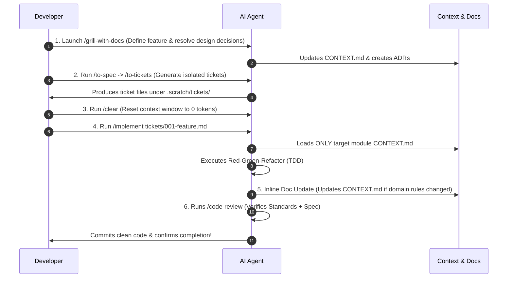

# Better Stack Clone: Master Architecture, AI Context System & Development Workflow

This document serves as the master blueprint for building a high-scale Better Stack clone using a **React Frontend**, a **Decoupled Backend**, **Deep Modules**, and a **Zero-Bloat Progressive AI Context System**.

---

## 1. Complete Production Folder Structure

```text
/ (Monorepo / Project Root)
├── AGENTS.md                                   # 🤖 Primary AI instructions & entrypoint map
├── CONTEXT-MAP.md                              # 🗺️ Master Context Index (maps domains to contexts)
├── CONTEXT.md                                  # 🌐 Global system-wide glossary ONLY
├── PROJECT_ARCHITECTURE_GUIDE.md               # 📄 This architecture & workflow blueprint
├── docs/
│   └── adr/                                    # 🏛️ System-wide Architecture Decision Records
│       ├── 0001-clickhouse-for-telemetry-logs.md
│       ├── 0002-postgres-for-relational-data.md
│       └── 0003-bullmq-redis-for-job-queues.md
│
│========================================================================================
│ ⚛️ FRONTEND: REACT CLIENT (Vite + TypeScript)
│========================================================================================
├── client/
│   ├── CONTEXT.md                              # 📍 Frontend architecture & state conventions
│   ├── index.html
│   ├── vite.config.ts
│   ├── src/
│   │   ├── assets/                             # Logos, static icons, CSS styles
│   │   ├── components/                         # UI Components
│   │   │   ├── ui/                             # 🧱 Design System Primitives (Button, Modal, Table, Input, Badge)
│   │   │   ├── layout/                         # 🖼️ App Shell (Sidebar, Header, UserMenu, Navigation)
│   │   │   └── feedback/                       # 🔔 Toast notifications, Loading spinners, Error boundary
│   │   │
│   │   ├── features/                           # 📦 DOMAIN FEATURE UI MODULES
│   │   │   ├── auth/                           # Login, Signup, MFA, Password Reset
│   │   │   ├── uptime/                         # Monitor List, Latency Chart, Monitor Form, Heartbeat grid
│   │   │   ├── incidents/                      # Incident List, Timeline, Escalation Policy Builder
│   │   │   ├── status-pages/                   # Status Page Customizer, Custom Domain Manager
│   │   │   ├── logs/                           # Log Explorer, Live Log Stream, Filter Bar
│   │   │   └── billing/                        # Subscription Plan Picker, Invoice List, Usage Meter
│   │   │
│   │   ├── api/                                # 🌐 API CLIENT LAYER
│   │   │   ├── client.ts                       # Axios / Fetch instance with Auth headers & Refresh Token interceptors
│   │   │   └── ws.ts                           # WebSocket / SSE client for real-time alerts
│   │   │
│   │   ├── store/                              # 🧠 Client State (Zustand - active team, auth state)
│   │   ├── utils/                              # 🧰 Client Utils (date formatting, latency score calculators)
│   │   ├── router/                             # 🚦 React Router / TanStack Router definitions
│   │   └── main.tsx
│   └── package.json
│
│========================================================================================
│ ⚙️ BACKEND: SERVER & BACKGROUND WORKERS (Node.js / TS / Go / Python)
│========================================================================================
└── server/
    ├── CONTEXT.md                              # 📍 Backend DB schemas, security rules, DB patterns
    ├── src/
    │   ├── config/                             # ⚙️ CONFIGURATION & ENVIRONMENT
    │   │   ├── env.ts                          # Zod-validated process.env wrapper
    │   │   └── constants.ts                    # Global constants (limits, retry counts)
    │   │
    │   ├── infrastructure/                     # 🛠️ SHARED INFRASTRUCTURE & ADAPTERS
    │   │   │
    │   │   ├── db/                             # 🗄️ DATABASES
    │   │   │   ├── postgres/                   # Primary Relational DB (Drizzle / Prisma / Knex)
    │   │   │   │   ├── schema/                 # Users, Teams, Monitors, Incidents, Subscriptions tables
    │   │   │   │   ├── migrations/             # SQL migration scripts
    │   │   │   │   ├── client.ts               # Connection pool instance
    │   │   │   │   └── seed.ts                 # Dev seed generator
    │   │   │   │
    │   │   │   └── clickhouse/                 # Time-Series Telemetry DB (Ping metrics & logs)
    │   │   │       ├── client.ts               # ClickHouse client
    │   │   │       └── migrations/             # Log & metric schema migrations
    │   │   │
    │   │   ├── queues/                         # 📥 JOB QUEUES (BullMQ / Redis)
    │   │   │   ├── redis.ts                    # ioredis connection instances (Publisher & Consumer)
    │   │   │   ├── queue.factory.ts            # Producer queue instantiator helper
    │   │   │   └── definitions/                # Job payload types & Queue names
    │   │   │       ├── ping.queue.ts           # High-frequency HTTP ping queue
    │   │   │       ├── alert.queue.ts          # SMS / Email / Webhook dispatch queue
    │   │   │       └── billing.queue.ts        # Stripe sync & quota check queue
    │   │   │
    │   │   ├── clients/                        # 🔌 3RD-PARTY EXTERNAL INTEGRATIONS
    │   │   │   ├── stripe.client.ts            # Stripe SDK wrapper
    │   │   │   ├── twilio.client.ts            # SMS & Voice call client
    │   │   │   ├── sendgrid.client.ts          # Email delivery client
    │   │   │   ├── slack.client.ts             # Slack bot & webhook client
    │   │   │   └── pagerduty.client.ts         # PagerDuty integration client
    │   │   │
    │   │   ├── logger/                         # 📝 STRUCTURED LOGGER
    │   │   │   └── index.ts                    # Pino / Winston instance (JSON output, log correlation IDs)
    │   │   │
    │   │   └── cache/                          # ⚡ CACHING LAYER
    │   │       └── redis-cache.ts              # Key-value Redis caching helper
    │   │
    │   ├── api/                                # 🌐 HTTP ENTRYPOINTS (Controllers & Routing)
    │   │   ├── server.ts                       # Express / Fastify app bootstrap
    │   │   ├── middlewares/                    # Request Middlewares
    │   │   │   ├── auth.middleware.ts          # JWT / Session validation
    │   │   │   ├── rate-limit.middleware.ts    # API rate limiter
    │   │   │   ├── validate.middleware.ts      # Generic Zod request validator middleware
    │   │   │   └── error.middleware.ts         # Centralized error handler
    │   │   │
    │   │   └── routes/                         # Route Controllers
    │   │       ├── auth.router.ts
    │   │       ├── monitors.router.ts          # /api/v1/monitors
    │   │       ├── incidents.router.ts         # /api/v1/incidents
    │   │       ├── status-pages.router.ts      # /api/v1/status-pages
    │   │       ├── logs.router.ts              # /api/v1/logs
    │   │       └── webhooks/                   # External Inbound Webhooks
    │   │           └── stripe.webhook.ts       # Listens to Stripe payment events (`customer.subscription.updated`)
    │   │
    │   ├── workers/                            # 👷 BACKGROUND WORKER PROCESSES
    │   │   ├── ping.worker.ts                  # Consumes ping.queue -> Executes HTTP pings
    │   │   ├── alert.worker.ts                 # Consumes alert.queue -> Sends SMS/Slack/Email
    │   │   └── index.ts                        # Background worker runner entrypoint
    │   │
    │   ├── modules/                            # 📦 DEEP DOMAIN MODULES (Core Business Logic)
    │   │   │
    │   │   ├── uptime/                         # Uptime Domain
    │   │   │   ├── CONTEXT.md                  # 📍 Uptime domain glossary & invariants
    │   │   │   ├── index.ts                    # 🔓 PUBLIC INTERFACE / SEAM
    │   │   │   ├── uptime.validator.ts         # ✅ Zod Schemas for create/update monitor
    │   │   │   ├── internal/                   # 🔒 Private implementation
    │   │   │   │   ├── checker.service.ts      # HTTP, SSL, DNS & TCP ping logic
    │   │   │   │   ├── latency-calc.ts         # Calculates 99.9% uptime SLA
    │   │   │   │   └── monitor.repository.ts   # DB access for monitors
    │   │   │   └── types.ts
    │   │   │
    │   │   ├── incidents/                      # Incidents & On-Call Domain
    │   │   │   ├── CONTEXT.md                  # 📍 Incidents domain glossary & invariants
    │   │   │   ├── index.ts                    # Public Interface
    │   │   │   ├── incident.validator.ts       # Zod validators for incidents
    │   │   │   └── internal/
    │   │   │       ├── escalation-engine.ts    # On-call rotation & escalation timer logic
    │   │   │       └── incident.repository.ts
    │   │   │
    │   │   ├── status-pages/                   # Status Pages Domain
    │   │   │   ├── CONTEXT.md                  # 📍 Status pages glossary & invariants
    │   │   │   ├── index.ts                    # Public Interface
    │   │   │   └── internal/
    │   │   │       ├── generator.ts            # Status page JSON / HTML builder
    │   │   │       └── domain-verifier.ts      # Custom domain CNAME/SSL verifier
    │   │   │
    │   │   └── billing/                        # Payments & Subscriptions Domain
    │   │       ├── CONTEXT.md                  # 📍 Billing domain glossary & invariants
    │   │       ├── index.ts                    # Public Interface (`checkQuota()`, `createCheckoutSession()`)
    │   │       ├── billing.validator.ts        # Zod schemas for checkout sessions & plans
    │   │       └── internal/
    │   │           ├── stripe.service.ts       # Stripe API calls & invoice sync
    │   │           └── quota.service.ts        # Enforces plan limits (e.g. max 50 monitors on Pro Plan)
    │   │
    │   └── shared/                             # 🧰 GENERAL BACKEND UTILITIES
    │       ├── utils/
    │       │   ├── crypto.ts                   # Hashing, token generation, API key encryption
    │       │   ├── date.ts                     # Timezone & duration helpers
    │       │   └── retry.ts                    # Exponential backoff utility for failed pings
    │       │
    │       └── errors/                         # Custom Application Error Classes
    │           ├── app-error.ts                # Base ApplicationError class
    │           ├── not-found.error.ts          # NotFoundError (404)
    │           ├── forbidden.error.ts          # ForbiddenError (403)
    │           └── quota-exceeded.error.ts     # QuotaExceededError (402 Payment Required)
    │
    └── package.json
```

---

## 2. Progressive AI Context Storage Setup

To ensure the AI agent **never bloats your context window**, setup three lightweight Markdown files in your root directory.

### File A: Root `AGENTS.md`
Add this to the very top of `AGENTS.md`:

```markdown
# AI Development Guidelines

## Context & Domain Pointers
Before working on any code, consult `CONTEXT-MAP.md` to locate the relevant domain context file.
- DO NOT read context files for unrelated modules.
- ALWAYS update the target module's `CONTEXT.md` inline whenever a domain term, rule, or invariant changes.

## Module Boundaries
- Every module in `server/src/modules/` is a DEEP MODULE.
- External code (routers, workers, other modules) MUST call the module ONLY through its public seam `index.ts`. Never import from `internal/`.
```

### File B: Root `CONTEXT-MAP.md`
This maps your architecture into distinct, isolated contexts:

```markdown
# Repository Context Map

- **Global System Context**: [`/CONTEXT.md`](file:///CONTEXT.md) — Cross-cutting concepts (Users, Teams, Roles).
- **Frontend App**: [`/client/CONTEXT.md`](file:///client/CONTEXT.md) — UI design rules, state management, router patterns.
- **Backend Infrastructure**: [`/server/CONTEXT.md`](file:///server/CONTEXT.md) — DB conventions, logging rules, error formats.
- **Uptime Module**: [`/server/src/modules/uptime/CONTEXT.md`](file:///server/src/modules/uptime/CONTEXT.md) — Monitor types, ping intervals, heartbeats, SLA calculations.
- **Incidents Module**: [`/server/src/modules/incidents/CONTEXT.md`](file:///server/src/modules/incidents/CONTEXT.md) — Escalation tiers, on-call schedules, alert routing.
- **Status Pages Module**: [`/server/src/modules/status-pages/CONTEXT.md`](file:///server/src/modules/status-pages/CONTEXT.md) — Custom domains, status badges, page generators.
- **Billing Module**: [`/server/src/modules/billing/CONTEXT.md`](file:///server/src/modules/billing/CONTEXT.md) — Stripe plans, subscription states, quota limits.
```

### File C: Module-Level `CONTEXT.md` (Example: `server/src/modules/uptime/CONTEXT.md`)
Keep each module context purely focused on domain terminology, invariants, and business rules (no implementation code):

```markdown
# Uptime Domain Context

## Glossary
- **Monitor**: A target endpoint (HTTP, SSL, TCP, Ping) checked on a fixed schedule.
- **Heartbeat**: An inbound signal sent by cron jobs or background servers.
- **SLA**: Service Level Agreement percentage calculated over a rolling 30-day window.

## Invariants
- Minimum ping interval allowed is 10 seconds.
- A monitor is marked `down` only after 2 consecutive failed check attempts.
```

---

## 3. End-to-End Workflow & Documentation Update Cycle

Here is the exact step-by-step development cycle you follow for every feature, bug fix, or module update.



### Step-by-Step Breakdown

#### Step 1: Idea Alignment & Grilling (`/grill-with-docs`)
When starting a new feature or module:
- Command: `/grill-with-docs`
- What happens: The AI interviews you about requirements, edge cases, and architectural choices.
- Documentation output: The AI automatically updates `server/src/modules/<module>/CONTEXT.md` and creates an Architectural Decision Record in `docs/adr/` if a hard-to-reverse decision was made.

#### Step 2: Spec & Ticket Creation (`/to-spec` -> `/to-tickets`)
- Command: `/to-spec` followed by `/to-tickets`
- What happens: The AI converts the conversation into a concrete spec file, then breaks it down into small, tracer-bullet ticket files (e.g., `.scratch/tickets/001-uptime-ping-schema.md`).

#### Step 3: Context Reset (`/clear`)
- Command: `/clear`
- What happens: Flushes the context window. Your AI session is reset to a clean slate (0 tokens).

#### Step 4: Test-Driven Implementation (`/implement`)
- Command: `/implement .scratch/tickets/001-uptime-ping-schema.md`
- What happens: 
  1. The AI reads `AGENTS.md` and `CONTEXT-MAP.md`.
  2. The AI loads **only** the target module's `CONTEXT.md` (e.g., `server/src/modules/uptime/CONTEXT.md`).
  3. The AI drives **TDD (`/tdd`)**: writes failing tests, writes minimal implementation to pass, refactors.

#### Step 5: Automatic Documentation Maintenance (Inline Update)
Whenever a code change introduces a new domain term, changes an invariant, or adds a key configuration rule:
- The AI immediately updates the target module's `CONTEXT.md` inline during the `/implement` step.
- If a tooling script or command changes (e.g. `npm run test` changes), the AI updates `AGENTS.md`.

#### Step 6: Code Review & Commit (`/code-review`)
- Command: Automatically run at the end of `/implement`.
- What happens: Runs a two-axis review (Standards + Spec) to ensure the code matches repository conventions and spec criteria before making a git commit.

---

## 4. How to Prompt the AI to Enforce This

Whenever you start a fresh session or ask the AI to build something, you can simply say:

> *"Follow the rules in `AGENTS.md` and `CONTEXT-MAP.md`. Load only the target module's `CONTEXT.md`. Keep modules deep behind `index.ts`. If domain rules or terms change during implementation, update the module's `CONTEXT.md` inline."*

By following this architecture and workflow, your codebase will stay modular, maintainable, highly testable, and completely resistant to AI context window bloat!
